# VisionAid – Kính thông minh tích hợp AI

**VisionAid** là kính thông minh tích hợp AI dành cho người khiếm thị. Bản này gồm hai module:

1. **Chỉ đường theo vạch** (gạch dẫn đường / vạch xúc giác): camera trên kính nhìn vạch và vật cản phía trước, nói hướng
   đi bằng tiếng Việt.
2. **Quan sát môi trường** (`quan_sat.py`): người dùng hỏi bằng giọng nói ("Phía trước có gì?", "Bên phải có gì?"), máy
   tính đưa khung hình mới nhất kèm câu hỏi cho **mô hình nhìn chạy ngay trên máy** (Qwen3-VL-2B), điện thoại đọc câu
   trả lời. Ảnh không gửi ra dịch vụ bên ngoài.

## Tác giả

**VisionAid do Đặng Đức Anh
- **Module chỉ đường theo vạch:** đo hai mép vạch và độ lệch, luật nói "dịch trái/phải", bộ điều khiển vật chắn trên vạch
  (chọn bên đi vòng, "Đã về vạch", nhớ xe chắn khi xe che mép vạch), né vật cản bằng độ sâu, cảnh báo xe đang tới và
  lọc báo nhầm, ưu tiên câu gấp.
- **Module quan sát môi trường:** nút Hỏi trên app, mô hình nhìn chạy trên máy (llama.cpp + Qwen3-VL-2B), công cụ thử
  trên video (`tools/thu_quan_sat.py`).
- **Kính ESP32 ảo** để phát lại video như camera kính thật, bộ quét câu mâu thuẫn, bộ test (hơn 300 test), video demo.

> **Bản thử nghiệm — CHƯA an toàn cho người dùng thật.** Mới kiểm trên video quay ở vỉa hè Hà Nội (phát lại như kính
> ESP32), chưa thử với người khiếm thị đi thật. Luôn dùng kèm gậy.

## Demo

**Video đầy đủ (3 phút 33 giây, có tiếng): [xem / tải tại mục Releases](https://github.com/ducanhdhtb06-hub/VisionAid/releases/tag/demo-v0.1)**

| Module 1: chỉ đường theo vạch | Module 2: quan sát môi trường |
|---|---|
| 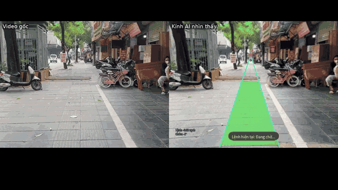 | 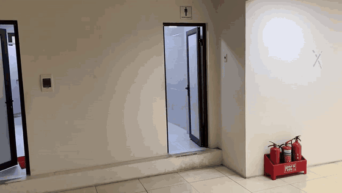 |

| Xe đỗ lấn vạch, kính bảo đi vòng | Xe chạy tới, kính bảo dừng |
|---|---|
| 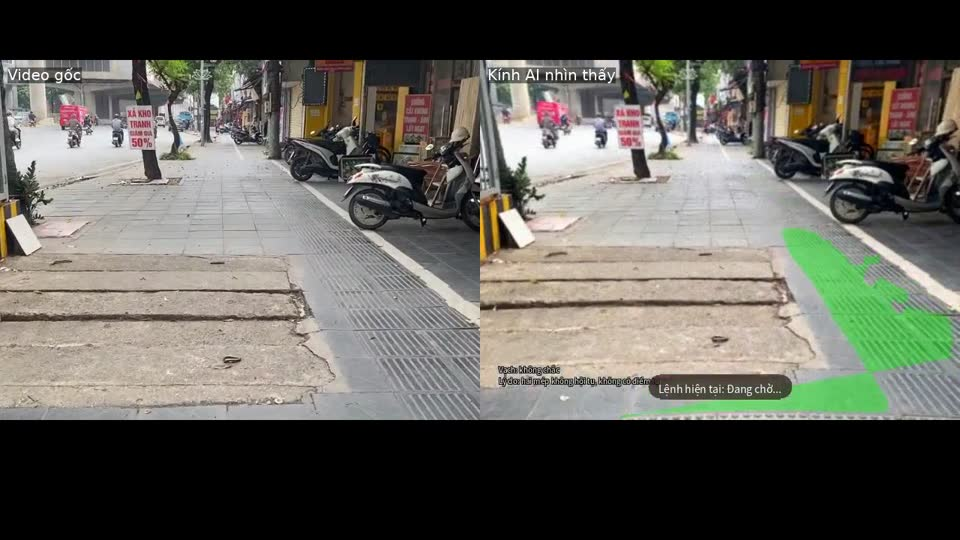 | 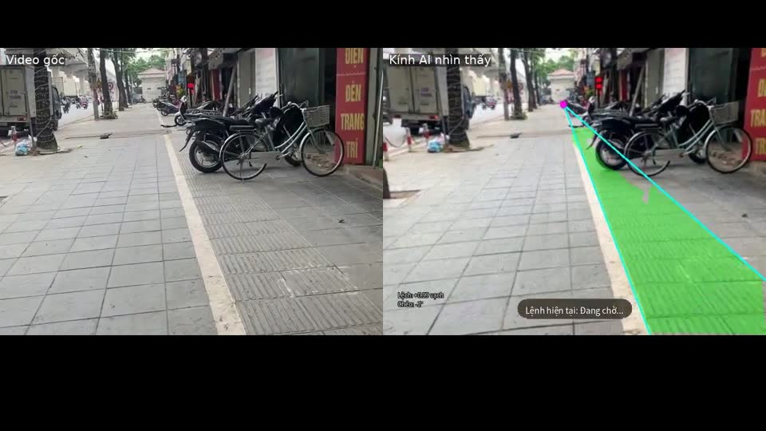 |

| Hỏi "Phía trước tôi là gì?" | Hỏi "Chữ ở biển xanh là gì?" |
|---|---|
| 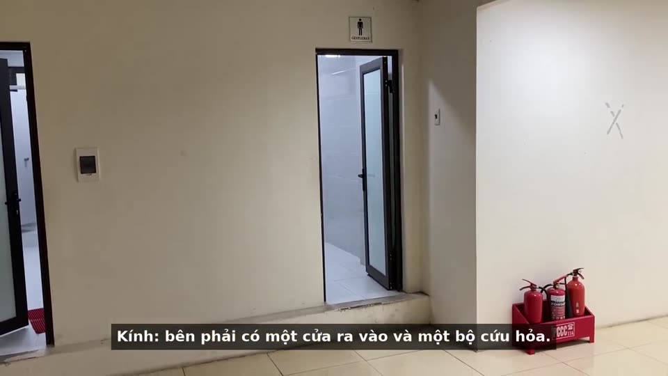 | 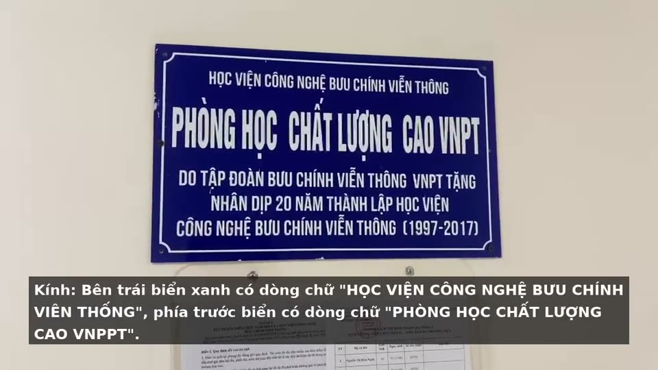 |

Mọi câu nói và hình vẽ trong video là đầu ra thật của hệ thống trên video quay bằng điện thoại, không dựng giả.
GIF và ảnh module 2 ở trên xuất lại ngày 11/11 bằng mô hình nhìn chạy trên máy (Qwen3-VL-2B), mỗi câu hỏi chạy một
lần, giữ nguyên kết quả (còn sai chính tả nhỏ khi đọc biển: "VIÊN THỐNG", "VNPPT"). Video module 2 bản mới (36 giây,
có phụ đề câu hỏi và câu trả lời): [`docs/video/demo_module2_qwen.mp4`](docs/video/demo_module2_qwen.mp4). Video đầy đủ
ở Releases quay ngày 30/10, phần quan sát trong đó còn dùng Gemini.

## App: điện thoại đóng vai kính

**Mở app: https://ducanhdhtb06-hub.github.io/VisionAid/**

Khi chưa có kính, camera điện thoại thay cho camera trên kính: kẹp điện thoại nằm ngang lên vành mũ, đeo tai nghe, bấm
"Bắt đầu dẫn đường". Ảnh được gửi về máy tính chạy AI, lời dẫn đọc qua tai nghe. Khi có kính, app giữ nguyên, chỉ đổi nguồn
hình.

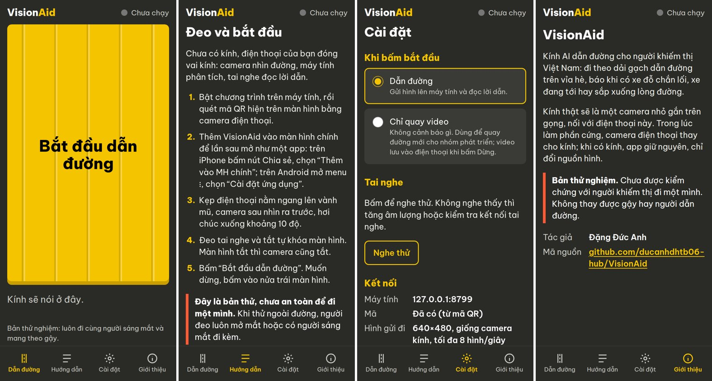

- Cài như app: trên iPhone bấm Chia sẻ → "Thêm vào MH chính"; trên Android mở menu ⋮ → "Cài đặt ứng dụng".
- **Hỏi kính:** khi đang dẫn đường, giữ nửa phải màn hình ("Giữ để hỏi"), nói câu hỏi ("Phía trước có gì?", "Bên phải
  có gì?") rồi thả tay. Điện thoại tự chuyển giọng nói thành chữ; máy tính hỏi **model nhìn chạy ngay trên máy**
  (Qwen3-VL-2B) với hình camera lúc đó, điện thoại đọc câu trả lời — **dưới 1 giây**, ảnh **không rời máy tính**.
  Trong lúc giữ nút, kính **im** (tiếng kính lọt vào micro làm câu hỏi bị nghe sai), kể cả cảnh báo: chỉ hỏi khi đang
  đứng yên. Thả tay xong, "Dừng lại" vẫn được nói trước, kể cả khi đang trả lời.
- App cần **máy tính chạy AI** đang bật: máy tính in một mã QR, quét mã đó để app biết gửi hình tới đâu. Mở link trần
  không quét mã thì xem được giao diện và hướng dẫn, nhưng chưa dẫn đường được.
- Mã nguồn app: [`app/`](app/) (HTML + JavaScript, không cần cài đặt gì).

## Kiến trúc

Các sơ đồ dưới đây mô tả hệ thống đầy đủ. Repo này chứa **hai module** cùng phần phụ thuộc cần để chạy test; máy chủ
`app_main.py`, `NavigationMaster`, phần nghe giọng nói và firmware kính lấy từ dự án gốc.

**Phần mềm**

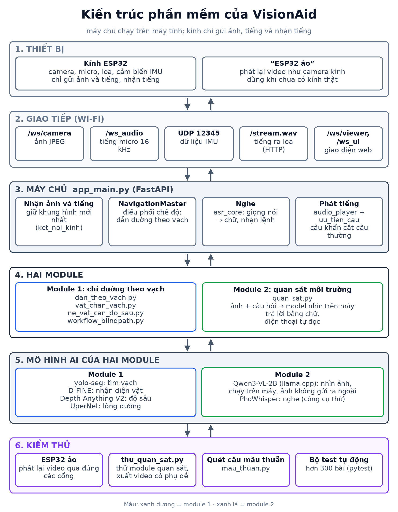

**Quy trình xử lý** (xanh: đã thử trên máy tính · cam: dự kiến · xám: ý tưởng)

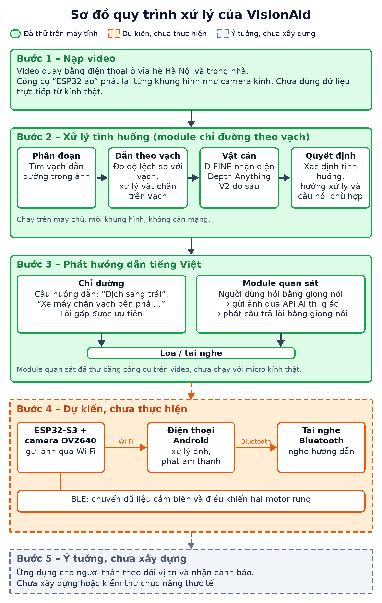

**Phần cứng:** hệ thống đã thử (kính gửi dữ liệu về máy tính) và phương án dự kiến (điện thoại Android, BLE, motor rung)

| Hệ thống đã thử | Phương án dự kiến (chưa thực hiện) |
|---|---|
| 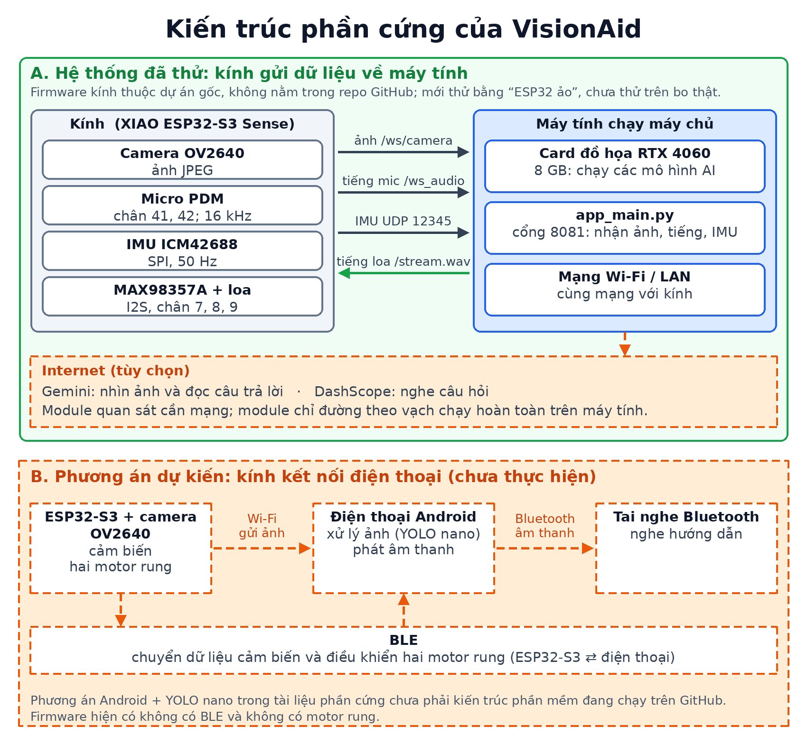 | 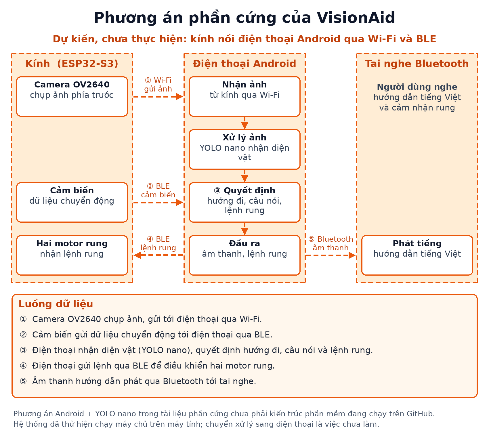 |

**Chi tiết từng module**

| Module 1: chỉ đường theo vạch | Module 2: quan sát môi trường |
|---|---|
| 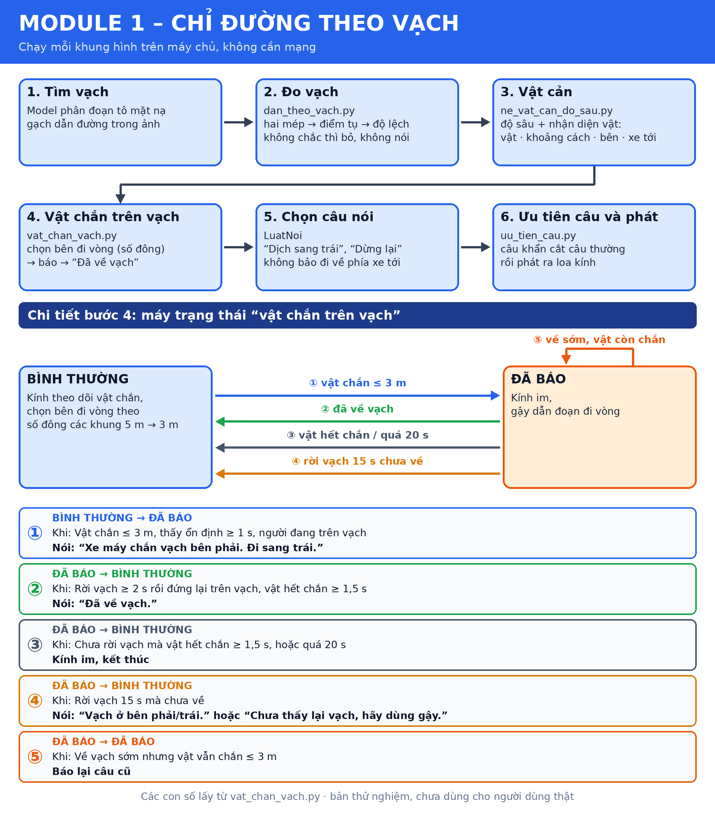 | 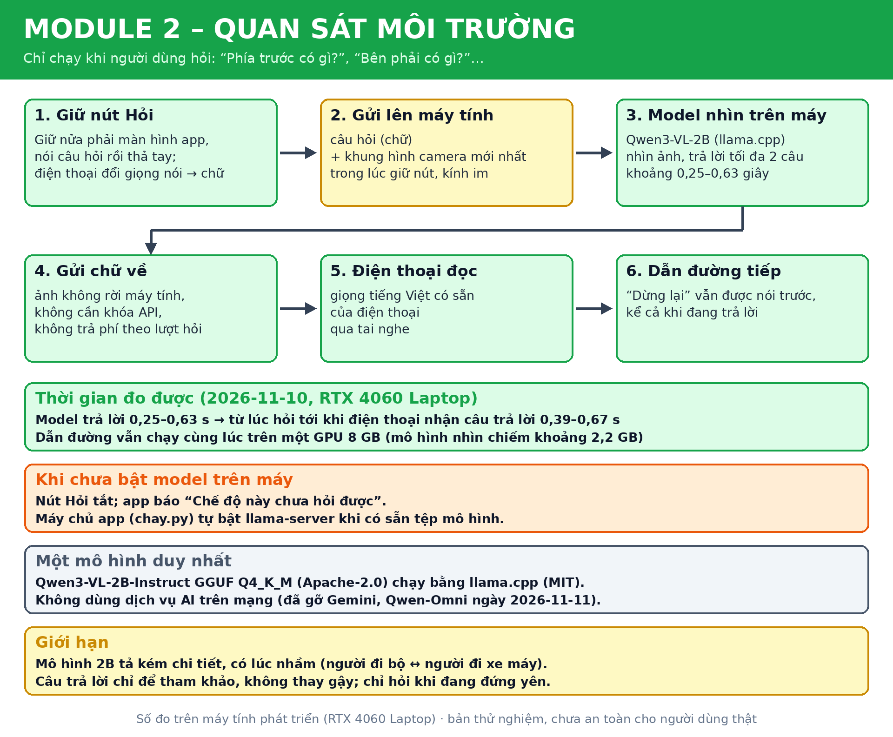 |

## Kính làm gì

| Tình huống | Kính nói |
|---|---|
| Tìm thấy vạch / lệch khỏi vạch | "Đã thấy vạch dẫn đường." / "Dịch sang trái" / "Dịch sang phải" |
| Vật đỗ đè lên vạch | "Xe máy chắn vạch bên phải. Đi sang trái." / "Xe máy chắn giữa vạch. Đi sang trái, dò gậy." / "… Dùng gậy dò đường vòng." |
| Đi vòng xong, về lại vạch | "Đã về vạch." |
| Xe đang chạy tới | "Xe máy, bên trái, đang tới" → "Dừng lại." |
| Mép vỉa hè, cầu thang, vật ngang đầu | "Sắp xuống lòng đường, phía trước", "Cầu thang lên, phía trước", "Dừng lại. Vật cản ngang đầu" |

Nguyên tắc: **một giọng nói, ít lời** — khi đang theo vạch chỉ quan tâm vật trong vùng vạch (vật cạnh vạch thì im),
không đọc số mét, không bao giờ bảo đi về phía lòng đường hay về phía xe đang lao tới; 5 loại nguy hiểm luôn báo.

## Module quan sát môi trường

Module 2 dùng **một mô hình duy nhất**, chạy ngay trên máy tính: [llama.cpp](https://github.com/ggml-org/llama.cpp)
`llama-server` (MIT) chạy **Qwen3-VL-2B-Instruct** bản GGUF Q4_K_M (Apache-2.0,
[Qwen/Qwen3-VL-2B-Instruct-GGUF](https://huggingface.co/Qwen/Qwen3-VL-2B-Instruct-GGUF)) trên GPU qua Vulkan, cổng tương
thích OpenAI `http://127.0.0.1:8090/v1` (`AIGLASS_MAY_NHIN_URL`). Máy chủ của app (`chay.py`) tự bật / tắt nó. Không cần
khóa API, không trả phí theo lượt hỏi, ảnh camera không rời máy tính. Câu trả lời là chữ, điện thoại tự đọc bằng giọng
tiếng Việt có sẵn. (Đến 10/11 module này còn dùng Gemini; đã gỡ ngày 11/11.)

| Đo 2026-11-10, RTX 4060 Laptop | |
|---|---|
| Một câu trả lời | 0,25–0,63 s |
| Từ lúc hỏi tới khi điện thoại nhận câu trả lời | 0,39–0,67 s |
| Bộ nhớ GPU | ~2,2 GB, chạy cùng phần dẫn đường trên 8 GB |
| Dẫn đường khi đang hỏi liên tục | mỗi khung 115 → 186 ms, hết hỏi thì về như cũ |

Đã thử model nhỏ hơn: SmolVLM2-256M ra chữ vô nghĩa với tiếng Việt; InternVL3-1B nói được nhưng dài dòng, bỏ sót cầu
thang và chậm hơn. Model 2B có lúc gọi nhầm (người đi bộ thành người đi xe máy).

Thử trên ảnh / video không cần kính (cần llama-server đang chạy, xem mục chạy máy chủ app):

```bash
python tools/thu_quan_sat.py video.MOV --xuat ket_qua.mp4   # nghe câu hỏi trong video, hỏi model, xuất video có phụ đề câu hỏi + câu trả lời
python tools/thu_quan_sat.py video.MOV --giay 10 30 --hoi "Phía trước có gì?"   # hoặc tự đặt câu hỏi và mốc giây
```
Không có `--hoi`, công cụ tìm các đoạn có người nói trong video, chép thành chữ bằng PhoWhisper (chạy trên máy, như kính
thật nghe câu hỏi) và chỉ hỏi model ở những câu là câu quan sát.

Nút Hỏi hiện chỉ có trên app điện thoại (điện thoại đọc câu trả lời). Đường kính ESP32 qua `app_main.py` của dự án gốc
chưa có nút hỏi: máy tính chưa có giọng đọc tiếng Việt chạy trên máy.

## Cấu trúc

```
OpenAIglasses_for_Navigation/
  dan_theo_vach.py        đo vạch (hai mép, độ lệch, chéo), luật nói dịch trái/phải, phân loại vật chắn/cạnh vạch (3D)
  vat_chan_vach.py        bộ điều khiển vật chắn trên vạch: chọn bên đi vòng, câu nói, "Đã về vạch", nhớ xe chắn
  ne_vat_can_do_sau.py    né vật cản bằng độ sâu (Depth Anything V2) + nhận diện (D-FINE), xe đang tới, mép vỉa hè
  quan_sat.py             module quan sát môi trường: ảnh + câu hỏi -> mô hình nhìn trên máy (Qwen3-VL-2B)
  uu_tien_cau.py          câu gấp ("Dừng lại", "đang tới", "chắn vạch") được chen ngang câu đang đọc
  workflow_blindpath.py   ghép tất cả vào luồng dẫn đường (BlindPathNavigator)
  audio_*.py, obstacle_detector_client.py, crosswalk_awareness.py   module hỗ trợ từ dự án gốc (để chạy được test)
  tools/thu_quan_sat.py   thử quan sát trên ảnh / video bằng API thật
  tools/esp32_ao/         "kính ESP32 ảo": phát lại video như camera kính thật (56°, mạng chậm), quét câu mâu thuẫn
  tests/                  test (pytest)
  docs/superpowers/       thiết kế (specs) và kế hoạch (plans) từng giai đoạn
loi_do_sau/
  ket_hop_3_model.py      lõi của module 1: độ sâu + nhận diện vật + theo dõi vật + bộ nói (Speaker)
  giong/, tao_giong.py    các mảnh giọng tiếng Việt (.wav) kính ghép thành câu khi tránh vật cản, và script tạo lại
  gia_lap_kinh.py         làm ảnh điện thoại giống camera kính rẻ (nhiễu, mờ, rơi khung)
  truc_tiep/              máy chủ cho app: iPhone gửi hình -> dẫn đường + nút Hỏi -> câu nói + WAV về iPhone
    chay.py               bật máy chủ, đường hầm / nối thẳng qua WiFi, mã QR, tự bật model nhìn trên máy
    may_chu.py            WebSocket nhận khung, chạy dẫn đường, gửi câu nói; nút Hỏi; nhật ký phiên
    hoi_dap.py            nút Hỏi: HoiTrenMay (mô hình nhìn trên máy)
    chung_chi.py          chứng chỉ https nội bộ để iPhone nối thẳng laptop (chỉ ký được cho IP nội bộ)
    static/               trang app (bản do máy tính phục vụ; app/ là bản đưa lên GitHub Pages)
```

## Cài và chạy test

```bash
python3.12 -m venv .venv && source .venv/bin/activate
pip install -r requirements.txt
cd OpenAIglasses_for_Navigation
python -m pytest tests -q          # không cần GPU / model / khóa API
```


| Biến | Mặc định | Ý nghĩa |
|---|---|---|
| `AIGLASS_DAN_VACH` | bật | dẫn theo vạch kiểu mới (`0` = luật gốc) |
| `AIGLASS_VAT_CHAN_VACH` | bật | bộ điều khiển vật chắn trên vạch (`0` = như cũ) |
| `AIGLASS_HFOV` | 70 | góc nhìn ngang camera (kính OV2640: 56) |
| `AIGLASS_NOI_KHOANG_CACH` | 0 | `1` = đọc số mét |

Không có khóa API nào trong mã; nếu dùng phần chat của dự án gốc, đặt khóa trong `.env` (đã nằm trong `.gitignore`).

## Chạy máy chủ cho app (iPhone làm kính)

```bash
# 1. Model nhìn trên máy cho nút Hỏi (một lần; ~1,6 GB). Không có thì nút Hỏi tắt (dẫn đường vẫn chạy).
mkdir -p ~/.local/opt ~/.local/share/glassai/qwen3vl
#    llama.cpp bản Vulkan cho Linux: https://github.com/ggml-org/llama.cpp/releases (llama-bXXXX-bin-ubuntu-vulkan-x64)
#    -> giải nén vào ~/.local/opt/ ; đặt AIGLASS_LLAMA_SERVER nếu đường dẫn khác mặc định trong chay.py
#    Qwen3VL-2B-Instruct-Q4_K_M.gguf + mmproj-Qwen3VL-2B-Instruct-Q8_0.gguf từ Qwen/Qwen3-VL-2B-Instruct-GGUF
#    -> ~/.local/share/glassai/qwen3vl/ (hoặc AIGLASS_QWEN_VL_DIR)
# 2. Bật máy chủ (từ thư mục gốc repo). iPhone và máy tính cùng WiFi, nối thẳng không qua Internet:
python -m loi_do_sau.truc_tiep.chay --noi-thang --trang-may-tinh
#    lần đầu: quét mã QR cài chứng chỉ trên iPhone (Cài đặt -> Cài đặt chung -> Giới thiệu -> Cài đặt tin cậy chứng
#    nhận -> bật), rồi quét mã QR mở app. Không chung WiFi: bỏ --noi-thang (đi qua đường hầm Cloudflare, chậm hơn).
#    Linux có tường lửa ufw: mở cổng 8765-8766 cho mạng nội bộ.
```

| Biến / cờ | Ý nghĩa |
|---|---|
| `AIGLASS_MAY_NHIN=0` | không bật model trên máy |
| `AIGLASS_MAY_NHIN_GPU` | GPU cho llama-server (mặc định tự chọn GPU NVIDIA; GPU tích hợp lấy RAM chung, dễ hết RAM) |

Test máy chủ: `python -m pytest loi_do_sau/truc_tiep -q` (test cần video mẫu / giọng đọc / bản gốc tự bỏ qua khi thiếu).


## Giới hạn đã biết

- Trong lúc giữ nút Hỏi, kính không báo nguy hiểm (để micro nghe rõ câu hỏi): chỉ hỏi khi đang đứng yên.
- Model nhìn trên máy (2B) tả kém chi tiết và có lúc sai; câu trả lời chỉ để tham khảo, không thay gậy.
- Câu trả lời do giọng tiếng Việt có sẵn của điện thoại đọc (iOS: tắt công tắc im lặng để nghe).

- Ước lượng "xe đang tới" chỉ dựa vào độ sâu từ một camera: khi người quay đầu nhanh, xe đỗ bên cạnh có thể bị báo nhầm
  là đang tới. Cần cảm biến chuyển động (IMU) trên kính để bù.
- Đôi khi gọi sai tên vật (xe máy -> "Ô tô"); hướng đi vòng vẫn đúng.
- Nhận lòng đường / vỉa hè đôi khi nhầm khi người ở trên vỉa hè nhưng không đứng trên vạch.
