# VisionAid – Kính thông minh tích hợp AI

**VisionAid** là kính thông minh tích hợp AI dành cho người khiếm thị. Bản này gồm hai module:

1. **Chỉ đường theo vạch** (gạch dẫn đường / vạch xúc giác): camera trên kính nhìn vạch và vật cản phía trước, nói hướng
   đi bằng tiếng Việt.
2. **Quan sát nhờ API** (`quan_sat.py`): người dùng hỏi bằng giọng nói ("Phía trước có gì?", "Chữ ở biển xanh là gì?"), kính
   gửi khung hình mới nhất kèm câu hỏi lên AI thị giác (Gemini hoặc Qwen-Omni) rồi đọc câu trả lời.

## Tác giả

**VisionAid do Đặng Đức Anh phát triển.** Bản MVP này dùng dự án mã nguồn mở
[OpenAIglasses_for_Navigation](https://github.com/AI-FanGe/OpenAIglasses_for_Navigation) (AI-FanGe, giấy phép MIT) làm
nền để chạy thử nhanh; các thành phần lấy từ dự án gốc sẽ được thay bằng mã tự phát triển ở giai đoạn sau.

**Phần do tác giả phát triển:**
- **Module chỉ đường theo vạch:** đo hai mép vạch và độ lệch, luật nói "dịch trái/phải", bộ điều khiển vật chắn trên vạch
  (chọn bên đi vòng, "Đã về vạch", nhớ xe chắn khi xe che mép vạch), né vật cản bằng độ sâu, cảnh báo xe đang tới và
  lọc báo nhầm, ưu tiên câu gấp.
- **Module quan sát nhờ API:** hỏi bằng giọng nói, nhìn ảnh bằng Gemini, đọc phát dần, chuyển khóa dự phòng, công cụ thử
  trên video (`tools/thu_quan_sat.py`).
- **Kính ESP32 ảo** để phát lại video như camera kính thật, bộ quét câu mâu thuẫn, bộ test (hơn 240 test), video demo.

**Phần lấy từ dự án gốc:** luồng dẫn đường (`workflow_blindpath.py`), phát âm thanh (`audio_*.py`), nhận diện vạch qua đường
(`crosswalk_awareness.py`) và khung ứng dụng.

> **Bản thử nghiệm — CHƯA an toàn cho người dùng thật.** Mới kiểm trên video quay ở vỉa hè Hà Nội (phát lại như kính
> ESP32), chưa thử với người khiếm thị đi thật. Luôn dùng kèm gậy.

## Demo

**Video đầy đủ (3 phút 33 giây, có tiếng): [xem / tải tại mục Releases](https://github.com/ducanhdhtb06-hub/VisionAid/releases/tag/demo-v0.1)**

| Module 1: chỉ đường theo vạch | Module 2: quan sát nhờ API |
|---|---|
| 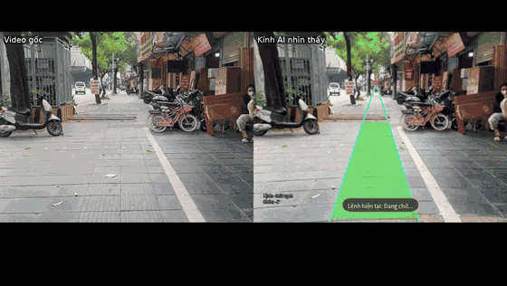 | 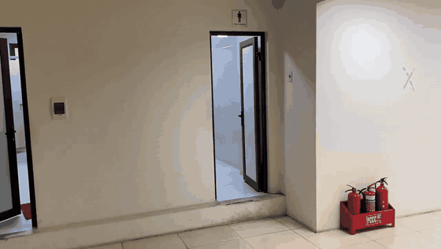 |

| Xe đỗ lấn vạch, kính bảo đi vòng | Xe chạy tới, kính bảo dừng |
|---|---|
| 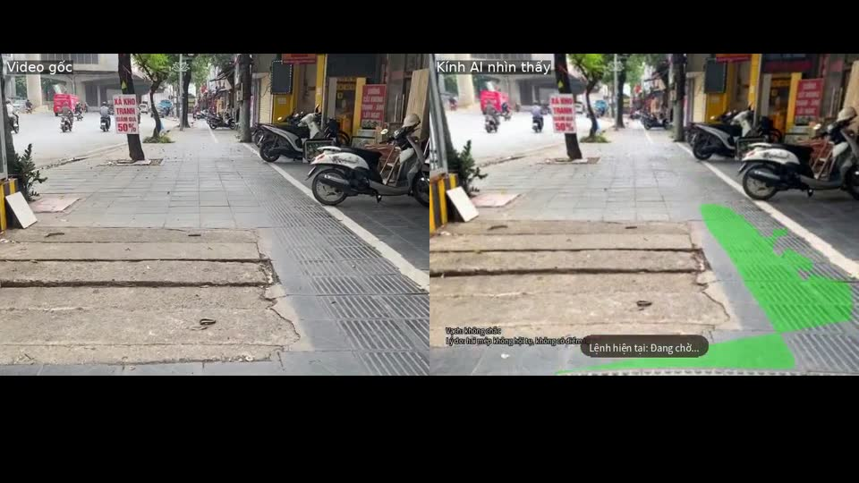 | 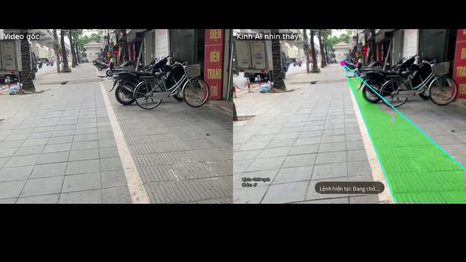 |

| Hỏi "Phía trước tôi là gì?" | Hỏi "Chữ ở biển xanh là gì?" |
|---|---|
| 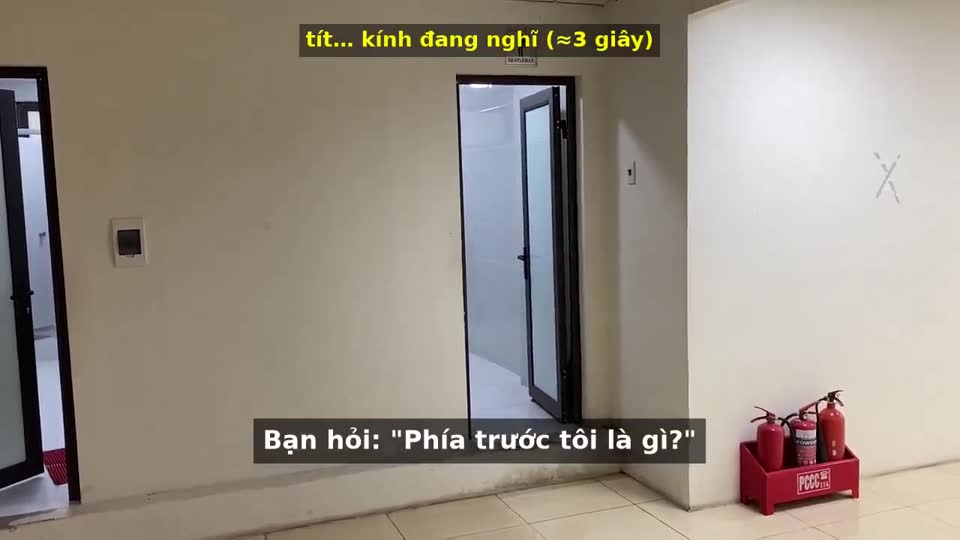 | 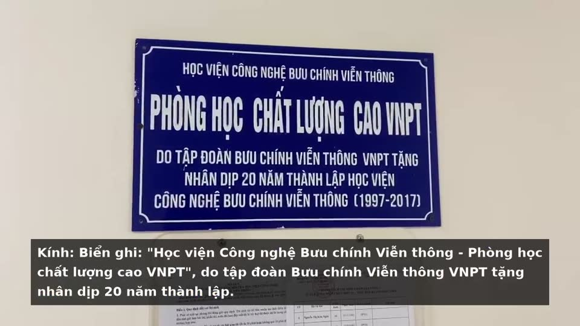 |

Mọi câu nói và hình vẽ trong video là đầu ra thật của hệ thống trên video quay bằng điện thoại, không dựng giả.

## Kiến trúc

Các sơ đồ dưới đây mô tả hệ thống đầy đủ. Repo này chứa **hai module** cùng phần phụ thuộc cần để chạy test; máy chủ
`app_main.py`, `NavigationMaster`, phần nghe giọng nói và firmware kính lấy từ dự án gốc.

**Phần mềm**

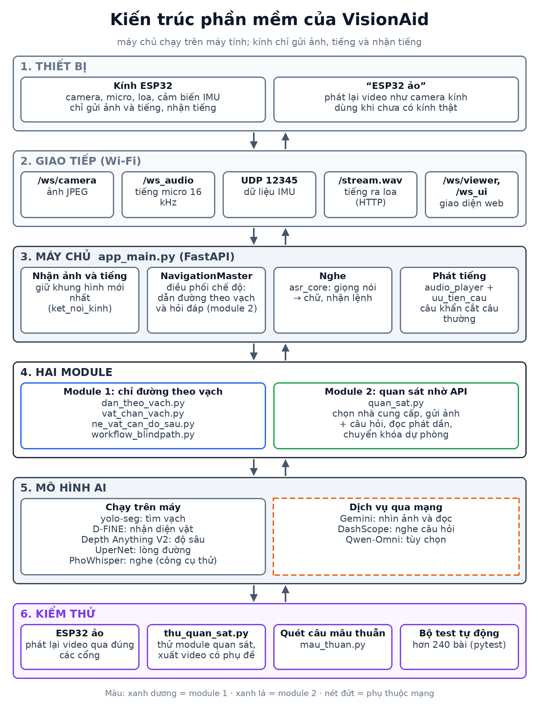

**Quy trình xử lý** (xanh: đã thử trên máy tính · cam: dự kiến · xám: ý tưởng)

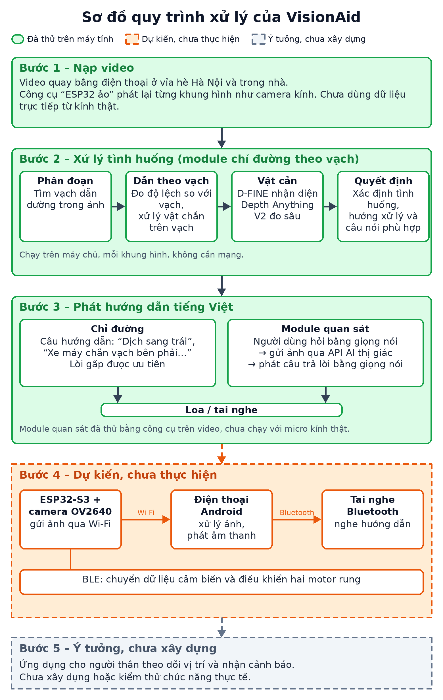

**Phần cứng:** hệ thống đã thử (kính gửi dữ liệu về máy tính) và phương án dự kiến (điện thoại Android, BLE, motor rung)

| Hệ thống đã thử | Phương án dự kiến (chưa thực hiện) |
|---|---|
| 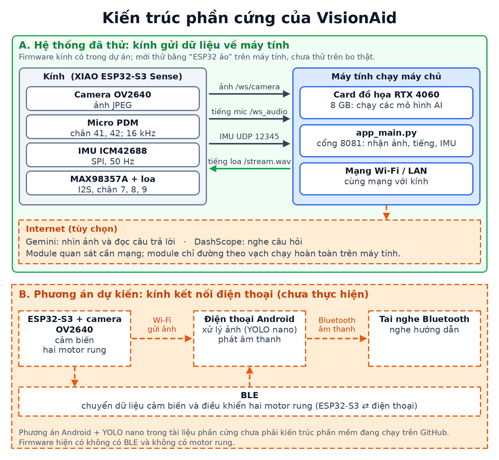 | 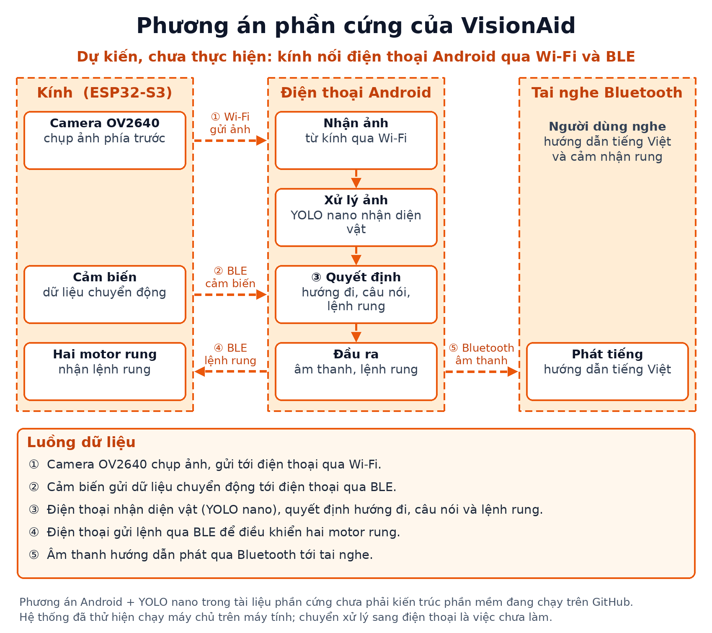 |

**Chi tiết từng module**

| Module 1: chỉ đường theo vạch | Module 2: quan sát nhờ API |
|---|---|
| 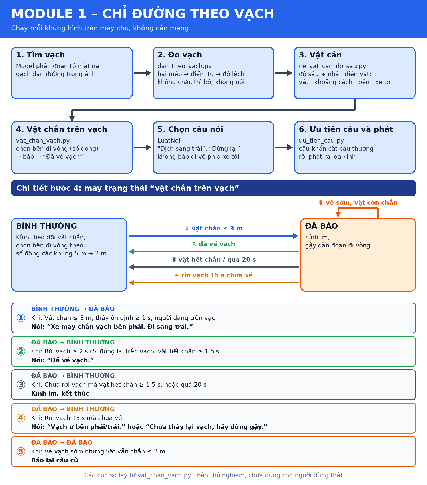 | 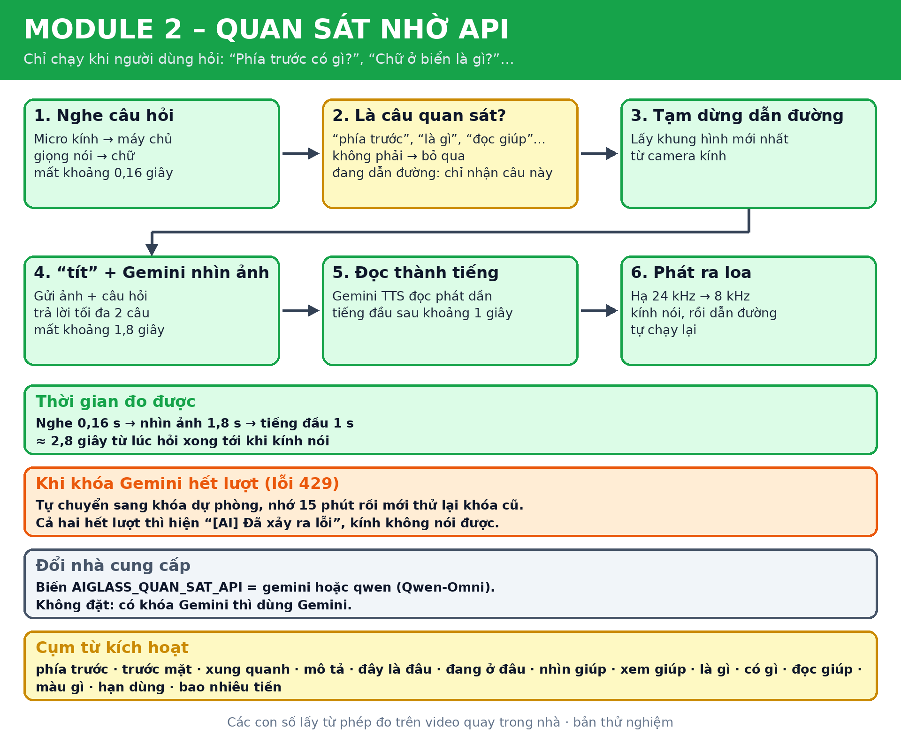 |

## Kính làm gì

| Tình huống | Kính nói |
|---|---|
| Tìm thấy vạch / lệch khỏi vạch | "Đã thấy vạch dẫn đường." / "Dịch sang trái" / "Dịch sang phải" |
| Vật đỗ đè lên vạch | "Xe máy chắn vạch bên phải. Đi sang trái." / "Xe máy chắn giữa vạch. Đi sang trái, dò gậy." / "… Dùng gậy dò đường vòng." |
| Đi vòng xong, về lại vạch | "Đã về vạch." |
| Xe đang chạy tới | "Xe máy, bên trái, đang tới" → "Dừng lại." |
| Mép vỉa hè, cầu thang, vật ngang đầu | "Sắp xuống lòng đường, phía trước", "Cầu thang lên, phía trước", "Dừng lại. Vật cản ngang đầu" |

Nguyên tắc: **một giọng nói, ít lời** — khi đang theo vạch chỉ quan tâm vật trong vùng vạch (vật cạnh vạch thì im),
không đọc số mét, không bao giờ bảo đi về phía lòng đường hay về phía xe đang lao tới; 5 loại nguy hiểm luôn báo.

## Module quan sát nhờ API

| Bước | Cách làm | Thời gian (đo 30/10, hành lang) |
|---|---|---|
| Nghe câu hỏi | giọng nói -> chữ (DashScope như dự án gốc; PhoWhisper chạy trên máy cũng chép đúng, 0,16 s) | |
| Nhìn ảnh | `gemini-3.1-flash-lite` qua cổng tương thích OpenAI, trả lời tối đa hai câu, nói bậc thềm / vật chắn trước | 1,8 s |
| Đọc câu trả lời | Gemini TTS phát dần (tiếng đầu ~1 s), "tít" ngay khi nhận câu hỏi | tổng ~2,8 s từ lúc hỏi tới tiếng đầu |

Chọn nhà cung cấp bằng biến môi trường (`.env`, không commit): `GEMINI_API_KEY` (thêm `GEMINI_API_KEY_2` làm khóa dự phòng: khóa nào hết lượt thì tự chuyển sang khóa kia), `AIGLASS_QUAN_SAT_API=gemini|qwen`,
`AIGLASS_GEMINI_MODEL`, `AIGLASS_GEMINI_TTS_MODEL`, `AIGLASS_GEMINI_GIONG`. Thử không cần kính:

```bash
python tools/thu_quan_sat.py video.MOV --xuat ket_qua.mp4   # một lệnh: nghe câu hỏi, hỏi AI, xuất video có phụ đề + tiếng kính trả lời
python tools/thu_quan_sat.py video.MOV --doc          # tự nghe câu hỏi trong video, hỏi AI, tạo tiếng đọc (.wav)
python tools/thu_quan_sat.py video.MOV --giay 10 30 --hoi "Phía trước có gì?"   # hoặc tự đặt câu hỏi và mốc giây
```
Không có `--hoi`, công cụ tìm các đoạn có người nói trong video, chép thành chữ bằng PhoWhisper (chạy trên máy, như kính
thật nghe câu hỏi) và chỉ hỏi AI ở những câu là câu quan sát.

Nối vào `app_main.py` của dự án gốc: `git apply patches/quan_sat_app_main.patch`.
Chi tiết, số đo từng model và giới hạn: `docs/superpowers/specs/2026-10-30-quan-sat-api-design.md`.

**Lưu ý:** gói miễn phí của Gemini giới hạn rất chặt (model đọc: 10 lượt mỗi ngày); gói đăng ký Google AI Pro **không** nâng
giới hạn của khóa API, phải bật thanh toán Cloud. Ảnh camera (có thể có người đi đường) được gửi ra máy chủ nhà cung cấp.

## Cấu trúc

```
OpenAIglasses_for_Navigation/
  dan_theo_vach.py        đo vạch (hai mép, độ lệch, chéo), luật nói dịch trái/phải, phân loại vật chắn/cạnh vạch (3D)
  vat_chan_vach.py        bộ điều khiển vật chắn trên vạch: chọn bên đi vòng, câu nói, "Đã về vạch", nhớ xe chắn
  ne_vat_can_do_sau.py    né vật cản bằng độ sâu (Depth Anything V2) + nhận diện (D-FINE), xe đang tới, mép vỉa hè
  quan_sat.py             module quan sát nhờ API: chọn nhà cung cấp, gửi ảnh + câu hỏi, đọc phát dần, "tít"
  uu_tien_cau.py          câu gấp ("Dừng lại", "đang tới", "chắn vạch") được chen ngang câu đang đọc
  workflow_blindpath.py   ghép tất cả vào luồng dẫn đường (BlindPathNavigator)
  audio_*.py, obstacle_detector_client.py, crosswalk_awareness.py   module hỗ trợ từ dự án gốc (để chạy được test)
  tools/thu_quan_sat.py   thử quan sát trên ảnh / video bằng API thật
  patches/                quan_sat_app_main.patch: nối quan sát vào app_main.py của dự án gốc
  tools/esp32_ao/         "kính ESP32 ảo": phát lại video như camera kính thật (56°, mạng chậm), quét câu mâu thuẫn
  tests/                  test (pytest)
  docs/superpowers/       thiết kế (specs) và kế hoạch (plans) từng giai đoạn
loi_do_sau/
  ket_hop_3_model.py      lõi của module 1: độ sâu + nhận diện vật + theo dõi vật + bộ nói (Speaker)
  giong/, tao_giong.py    các mảnh giọng tiếng Việt (.wav) kính ghép thành câu khi tránh vật cản, và script tạo lại
```

## Cài và chạy test

```bash
python3.12 -m venv .venv && source .venv/bin/activate
pip install -r requirements.txt
cd OpenAIglasses_for_Navigation
python -m pytest tests -q          # không cần GPU / model / khóa API
```

Chạy thật trên camera cần thêm phần còn lại của dự án gốc
[OpenAIglasses_for_Navigation](https://github.com/AI-FanGe/OpenAIglasses_for_Navigation) (máy chủ `app_main.py`,
model phân đoạn vạch từ ModelScope `archifancy/AIGlasses_for_navigation`). Model độ sâu / nhận diện / lòng đường
(Hugging Face) tự tải lần đầu chạy. Các công tắc chính (biến môi trường):

| Biến | Mặc định | Ý nghĩa |
|---|---|---|
| `AIGLASS_DAN_VACH` | bật | dẫn theo vạch kiểu mới (`0` = luật gốc) |
| `AIGLASS_VAT_CHAN_VACH` | bật | bộ điều khiển vật chắn trên vạch (`0` = như cũ) |
| `AIGLASS_HFOV` | 70 | góc nhìn ngang camera (kính OV2640: 56) |
| `AIGLASS_NOI_KHOANG_CACH` | 0 | `1` = đọc số mét |

Không có khóa API nào trong mã; nếu dùng phần chat của dự án gốc, đặt khóa trong `.env` (đã nằm trong `.gitignore`).

## Giấy phép

Mã ở đây theo **MIT** (xem `LICENSE`; phần lấy từ dự án gốc giữ bản quyền AI-FanGe).

## Giới hạn đã biết

- Ước lượng "xe đang tới" chỉ dựa vào độ sâu từ một camera: khi người quay đầu nhanh, xe đỗ bên cạnh có thể bị báo nhầm
  là đang tới. Cần cảm biến chuyển động (IMU) trên kính để bù.
- Đôi khi gọi sai tên vật (xe máy -> "Ô tô"); hướng đi vòng vẫn đúng.
- Nhận lòng đường / vỉa hè đôi khi nhầm khi người ở trên vỉa hè nhưng không đứng trên vạch.
